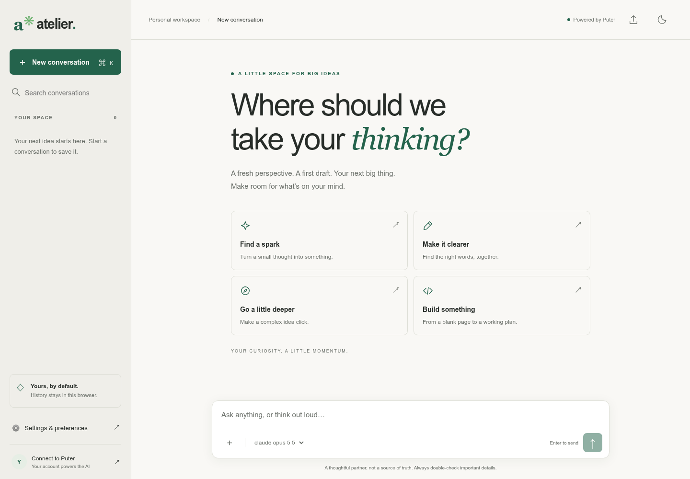

# Atelier

**A little space for your biggest ideas.** A responsive, local-first AI chat interface built with vanilla JavaScript and Puter.js. No build step, API keys, application server, or paid hosting required by this project.

> AI usage is provided by Puter, not by this repository. A Puter account, available models, permissions, account limits, and usage charges may apply. This project does not provide unlimited or guaranteed free Claude access.



## Quick start

Install [Node.js 20+](https://nodejs.org/), download this repository, and run:

```bash
npm start
```

Open **http://localhost:3000**, click **Connect to Puter**, then send a message. No `npm install` is needed for the app, local server, or unit tests: there are no runtime npm dependencies.

Use an HTTP server rather than double-clicking `index.html` (`file://`), because the app uses JavaScript modules and browser authentication. Production requires internet access to `https://js.puter.com/v2/` and Puter services. Offline inference is not supported.

## Deploy to GitHub Pages

1. Create a GitHub repository and upload **the contents of this folder** to its root. Keep `index.html`, `src/`, `assets/`, and `.github/workflows/deploy.yml` together; do not upload the ZIP itself as your website.
2. Use `main` as the branch name, or edit the workflow branch filter.
3. In the repository, open **Settings → Pages → Build and deployment → Source → GitHub Actions**.
4. Push a commit to `main`, or run **Actions → Deploy to GitHub Pages → Run workflow**.
5. The workflow runs syntax checks and unit tests, uploads only public app files, and deploys the site. Find your published URL in the workflow's deployment output or Pages settings.

All asset paths are relative, so both `username.github.io/` and `username.github.io/repository/` work without configuration.

Prefer Git if your file picker hides dotfolders:

```bash
git init
git add .
git commit -m "Add Atelier AI chat"
git branch -M main
git remote add origin https://github.com/YOUR_USERNAME/YOUR_REPOSITORY.git
git push -u origin main
```

Alternative: select **Deploy from a branch**, `main`, `/ (root)` in Pages settings if you do not want Actions. The application needs no compilation. Disable/remove the Actions workflow when using that approach.

Other static hosts work too: publish the root folder with no build command. Never add API keys to browser JavaScript or commit secrets.

## Your Claude model

Your original model ID is intentionally preserved:

```js
anthropic/claude-opus-5-5
```

**Its availability is not guaranteed or independently verified.** The application does not silently substitute another model or claim the identifier is valid. It loads `puter.ai.listModels()` and offers the exact Claude IDs returned by Puter. Your configured ID remains selectable even if it does not appear in the catalog.

If you see a model error:

1. Open **Settings & preferences → Refresh live model catalog**.
2. Close settings and choose an available model in the selector below the message box; or enter an exact model ID in settings and save.
3. Retry the failed response. Authentication, regional availability, pricing, and model permissions may differ by account.

System instructions, model, and output token limits apply to future replies, including regenerated replies. They are global preferences, not per-conversation settings. No arbitrary temperature is sent, because some models reject it.

## Features

- Streamed, multi-turn conversations with system instructions and complete saved text history.
- Stop generation using `AbortController`; retry errors or regenerate the last assistant response.
- Editable user messages. Confirming an edit removes that message and all subsequent replies, then returns its text and attachments to the composer.
- Browser-local saved conversations with search, rename, delete, and draft preservation while switching chats (drafts are memory-only, not saved across reloads).
- Light, dark, or device-matched appearance; responsive mobile sidebar.
- Live Claude model catalog and custom model IDs.
- HTML-disabled Markdown: headings, bold, italic, inline/fenced code, simple lists, blockquotes, simple tables, and safe links. Copy response or individual code blocks. Raw HTML/images are displayed as text, never executed. This intentionally small renderer is not a complete CommonMark implementation and does not provide syntax highlighting, LaTeX, or nested-list rendering.
- Up to three **plain-text/code attachments**, 100 KB each, per message. File contents are included as reference text in the model context; not uploaded to Puter Drive. PDFs, images, and binary files are intentionally not supported.
- Markdown export of the current chat; JSON backup/restore of all chats and preferences, with schema validation. Import replaces existing history after confirmation.
- Keyboard: **Enter** sends, **Shift+Enter** inserts a newline, **Cmd/Ctrl+K** starts a new conversation. IME composition is respected. Accessible labels, visible focus, skip link, modal settings, status announcements, and reduced-motion support.
- Explicit loading, storage, SDK, account-limit, empty-response, and model-error handling.

## Files

```text
.
├── index.html                  # Application shell and Puter.js loader
├── src/
│   ├── app.js                  # UI, streaming, settings, files, authentication
│   ├── core.js                 # Data validation, response/context adapters, export
│   ├── markdown.js             # Safe DOM-only Markdown subset renderer
│   └── styles.css              # Responsive light/dark interface
├── assets/favicon.svg
├── server.mjs                  # Development-only static server
├── tests/
│   ├── core.test.mjs           # Dependency-free unit tests
│   └── browser.test.mjs        # Optional Playwright integration smoke tests
├── .github/workflows/deploy.yml
├── .gitignore
├── .nojekyll
├── package.json
├── LICENSE
└── README.md
```

## Development and testing

```bash
npm run check
npm test
```

Optional browser tests (not required to run or deploy):

```bash
npm install --no-save playwright
npx playwright install chromium
npm run test:browser
```

Or set `CHROMIUM_PATH` to an existing Chromium executable:

```bash
CHROMIUM_PATH=/path/to/chromium npm run test:browser
```

The browser test starts its own local server on port 4173 and **mocks Puter**, so it needs no credentials and incurs no AI usage. It exercises streaming, conversation context, persistence, safe rendering, stopping, error/retry, text attachments, settings, export, and mobile navigation. Core tests cover validation and context construction. GitHub Actions runs only syntax/unit tests, not Playwright.

**Validation boundary:** the delivered app was checked with syntax/unit tests, mocked browser interactions, and visual previews. Live Puter authentication, account billing, and a real Claude completion require your account and were not exercised. Before launch, connect to Puter, select a listed model, send two messages, stop a longer response, refresh to verify history, and export a backup.

## Privacy, security, and limitations

- History and settings are in `localStorage` under `atelier.chat.v1`, **not encrypted**, not synchronized across browsers, and not private from other people/scripts with access to the same browser origin. Use a dedicated deployment origin for sensitive data. Signing out of Puter does **not** delete local history.
- Sending transmits the configured system instructions and the conversation's text and attachments to Puter/its model providers. Review their current privacy policy and terms. Do not share sensitive data without appropriate authorization.
- JSON backups and Markdown exports contain message/file text. Treat them as sensitive. Import replaces current history after confirmation; export first. Clearing history removes the app's stored conversations but does not erase provider-side records, downloaded backups, or browser backups.
- No tools, agent actions, shell execution, retrieval, web browsing, image generation, speech, or cloud sync are wired up. The assistant must not be relied on for claims of performing those actions.
- All prior valid conversation messages are resent on every turn. There is no automatic truncation or token estimation. Very long chats can hit provider context limits and cost more; start a new conversation when necessary. Error replies are excluded from subsequent context; nonempty stopped replies are included.
- Browser storage typically holds only a few MB. The app warns on storage failures. Back up regularly. In-flight responses are periodically saved; a reload restores a partial response as stopped. A crash can lose the latest streamed text.
- Defensive limits: 500 conversations, 2,000 messages per conversation, 20,000 messages per imported backup, 20 MB import size, 1,000,000 characters per assistant response, and 100,000 characters typed per message. These are safety caps, not a promise that browser storage can fit them.
- Canceling signals the SDK and stops local output, but already-generated tokens may still be charged. Do not assume cancellation reverses usage.
- Puter.js is loaded from Puter's hosted `/v2/` SDK. The site depends on that third-party script and its future API compatibility. No additional external font, analytics, or Markdown scripts are loaded.
- Browser support: modern Chrome, Edge, Firefox, and Safari with ES modules, async iterators, `AbortController`, `crypto.randomUUID`, and native `<dialog>`. Clipboard copying requires HTTPS or localhost and may require permission. If blocked, select/copy text manually.
- Do not run the included development server as a public production service. Use a static host.

## Puter references

- [Puter.js overview](https://docs.puter.com/)
- [`puter.ai.chat()` — messages, streaming, cancellation](https://docs.puter.com/AI/chat/)
- [`puter.ai.listModels()` — current model catalog](https://docs.puter.com/AI/listModels/)
- [Stream chunk reference](https://docs.puter.com/Objects/chatresponsechunk)

## License

MIT. This is an independent starter project, not an official Anthropic or Puter product. Model names belong to their respective owners.
